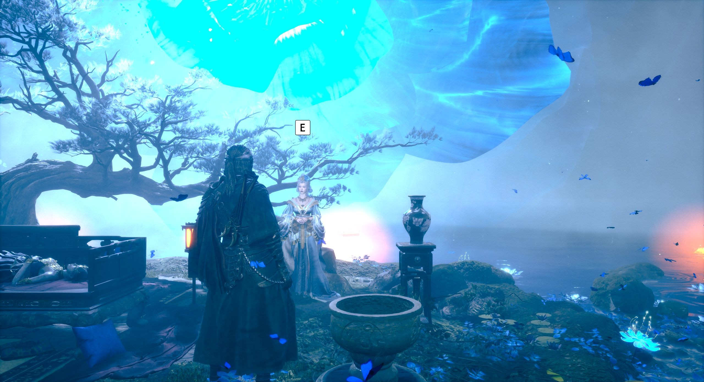
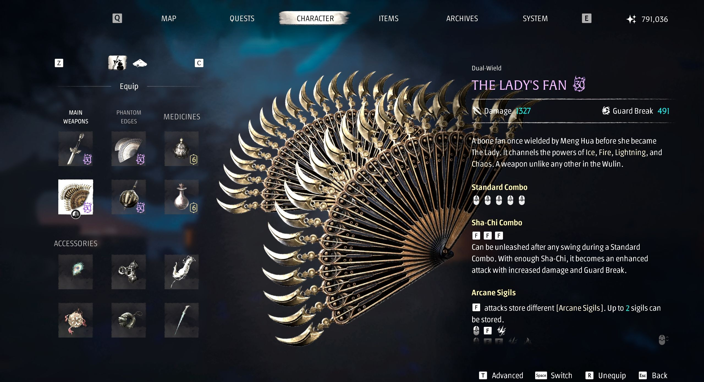
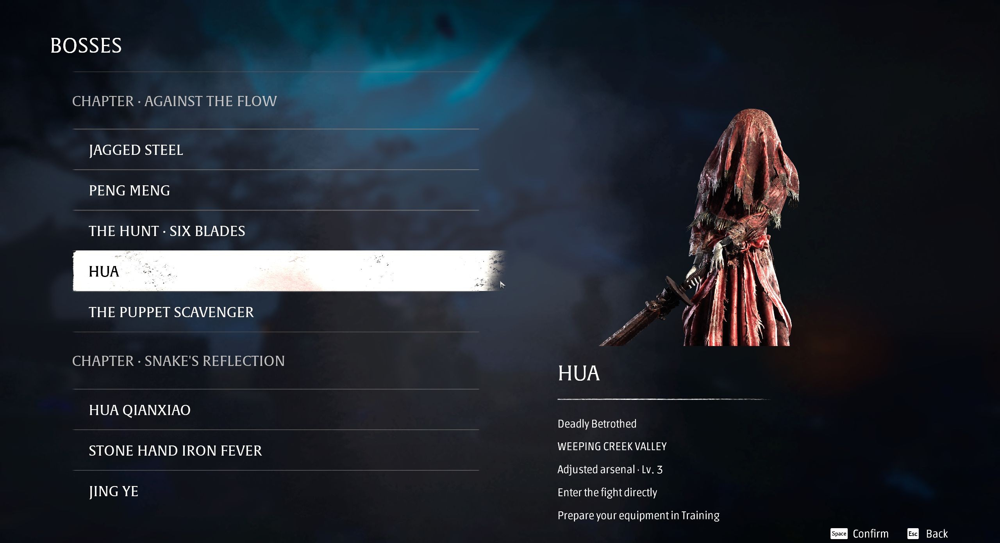
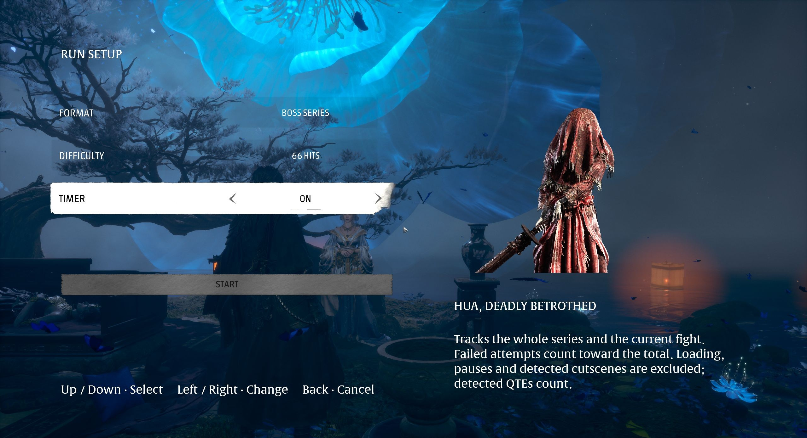
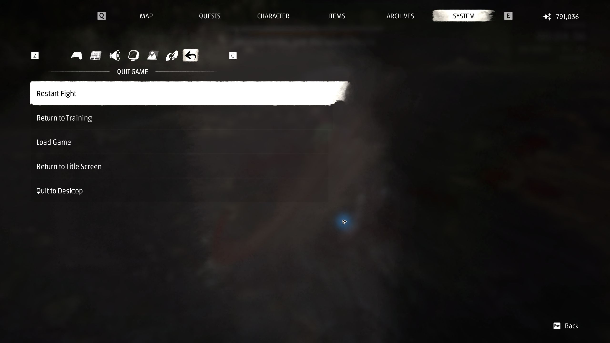
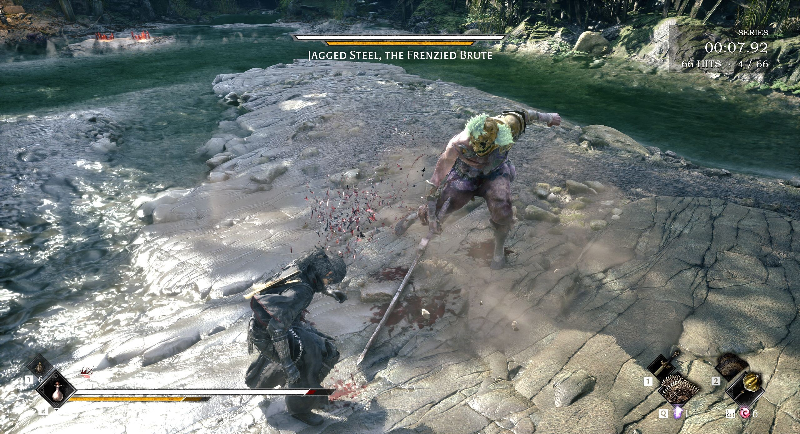

# BOSSES feature guide

This guide describes preview **0.7.0-preview.6** for Steam build **26367565**. The catalogue contains spoilers. Installation and recovery instructions are in the [README](README.md).

## Prepare at Inanis’s refuge

The **BOSSES** title-screen entry opens the training refuge. Use the game’s inventory to equip and try weapons, spectral blades, accessories and remedies. Speak to Inanis, or press **F8**, to open encounter selection without returning to the title screen. Campaign dialogue and the normal exit portal are disabled in the training session.

The training arsenal includes **24 weapons, 24 spectral blades, 51 accessories and 15 remedies obtainable in the campaign**, regardless of what your own campaign has unlocked. Weapons use level 30 and their forge upgrade in the refuge. Equipment levels then adapt to the selected fight, without NG+ bonuses. This balancing is provisional. Equipment rewards are suppressed to avoid duplicate items; training changes are not transferred back to the campaign.

## Choose an encounter

The list contains **59 selectable encounters**, organized by chapter, with character portraits to help identify them. Variants such as the five masked-man trials have separate entries. The Jade Dancer / Iron Fiend duo is one encounter; its old duplicate remains only in the historical test register.

Five sequences are excluded: two prologue encounters with Zuo Shang, the chariot, Yucong’s first appearance and Hansui. An entry in the list does not mean that every phase or final execution has been verified; check the [manual follow-ups](mod/Validation/QA-English.md#manual-follow-ups).

## Configure the run

| Setting | Behavior |
|---|---|
| Format | One fight, or a series starting with the selected encounter |
| Difficulty | Wayfarer, Pathbreaker, Hellwalker, or the custom 66 HITS challenge |
| Timer | Off or on, independently of the run format |

Use **Up/Down** to select a setting and **Left/Right** to change its value. With the mouse, use the arrows beside a setting. Move to **Start** and hold the indicated button for **1.5 seconds** to confirm. Back cancels the draft settings. Changing a setting should not itself launch the fight.

For a complete series, choose the first encounter in the list. For practice, choose a single fight and enable the timer if wanted. Timing does not force automatic progression.

## Enter, retry and leave a fight

Where identified, native events start the introduction and encounter. Other entries place the player near and facing the opponent. The mod protects the entry transition while the game is not ready to accept controls. If initialization cannot be confirmed, a recovery menu offers retry or return to training.

A normal death retries the encounter with the selected equipment preserved and remedies refilled. Open the native **System → Quit game** area for **Restart fight** or **Return to training**, alongside the usual exit options. These actions are scoped to the BOSSES session.

The mouse-focus correction keeps one action highlighted. In the targeted live check, clicking **Restart Fight** opened its confirmation and **Cancel** closed it; confirming **Return to Training** returned to Inanis and stopped the run. That check did not confirm an actual restart or physical controller behavior.

After victory, choose to replay, select another encounter or return to training. In series mode, the next encounter starts automatically. Returning to training abandons the current run. Runs cannot be resumed after closing the game.

## Timer

| Mode | What is timed |
|---|---|
| Single fight | The current attempt; death or restart resets its time |
| Series | Accumulated combat time, including failed attempts |

Recognized loading screens, pauses and cinematics are excluded. Detected QTEs count as combat. The timer is a practice aid, not a certified speedrun timing system: detection of every special transition is not guaranteed.

The compact timer sits in the **upper-right corner**, with a smaller, translucent background. The screenshot below shows it during a live diagnostic encounter, alongside the **4/66** hit counter. It illustrates the HUD, not a completed 66-hit challenge.

## 66 HITS

66 HITS uses **Hellwalker** combat difficulty and a shared budget of **66 enemy hits**. It can be used for one fight or a series, with or without the timer. The campaign’s separate 66 Days mode is not offered here.

- The **66th counted hit causes death, ends the run and returns to Inanis**, showing the last encounter reached. Automatic progression stops.
- Healing, ordinary deaths and restarting an encounter do not refund hits.
- Starting a new configured run creates a new challenge.
- Uncertain damage attribution is marked in the HUD instead of being treated as fully verified detection. Projectiles, damage over time and parry edge cases need further testing.

The earlier targeted 66-hit test observed the native death path, automatic refuge return and a stopped timer. That evidence belongs to its recorded build; it is not a claim that every enemy attack has been verified.

## Validation and reporting a problem

The [English QA summary](mod/Validation/QA-English.md) separates encounter entry, engine input, physical input and full victory. Previous tests cover several builds. Neither a translated interface nor a successful launch revalidates every encounter.

When reporting a problem, include the mod version, Steam build, encounter, run format, difficulty, timer/66 HITS settings, whether the intro was skipped, and the last action before the problem. A short clip or screenshot can help. Avoid sharing campaign saves, account identifiers or private paths unless they are specifically needed and reviewed.

Restore before returning to your campaign. See the README for recovery after a crash and for the supported installation setup.
