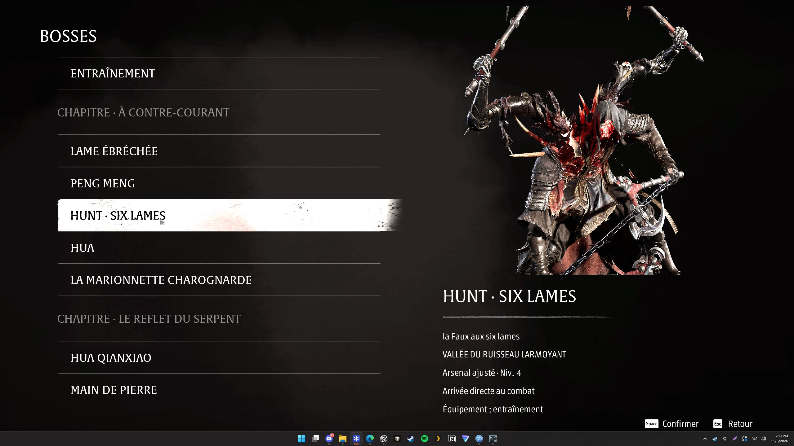

# BOSSES — Phantom Blade Zero

Mod communautaire pour rejouer **60 rencontres regroupées par chapitre**, avec portraits, chronomètre et défi 66 HITS. **0.7.0-preview.1 expérimentale — Steam build 26367565.** Le menu révèle les boss : attention aux spoilers.

**Préversion non validée en jeu.** Les tests automatisés de la logique passent, mais le nouvel affichage, le comptage des coups réels et la détection des QTE doivent être essayés dans le jeu. Pour une session normale, préférer la [0.6.2](https://github.com/kevinbarfleur/phantom-blade-zero-bosses/releases/tag/v0.6.2).

Cette version reprend le lanceur protégé de la 0.6.2. Elle utilise **PBZModLoader 1.0.0 de LLKKFF**, sans remplacer les scripts originaux du jeu.



## Installation

Windows, pare-feu Windows actif, droits administrateur et **une seule sauvegarde principale locale**. Installation Steam par défaut uniquement :

```text
C:\Program Files (x86)\Steam\steamapps\common\PBZ
```

1. Après une mise à jour du jeu, le lancer **une fois depuis Steam en ligne, sans mod**, jusqu'au menu principal, puis le fermer. Cela laisse le jeu terminer sa préparation avant la session protégée.
2. [Télécharger BOSSES 0.7.0-preview.1](https://github.com/kevinbarfleur/phantom-blade-zero-bosses/releases/download/v0.7.0-preview.1/PBZ-Bosses-0.7.0-preview.1.zip) et **tout extraire** dans un dossier permanent et inscriptible. Une copie indépendante de ses sauvegardes reste recommandée.
3. Télécharger **PBZModLoader 1.0.0**, fichier principal, sur la [page officielle de LLKKFF](https://www.nexusmods.com/phantombladezero/mods/113?tab=files). Laisser son ZIP dans Téléchargements, ou le placer à côté de `Lancer-Bosses.cmd`. **Ne pas l'installer manuellement.** Le lanceur reconnaît et vérifie cette archive précise.
4. Ouvrir `Lancer-Bosses.cmd` normalement, puis valider la demande Windows du gardien. Il protège les sauvegardes, bloque temporairement le réseau et installe les fichiers nécessaires pour cette session.

Le dossier [`mod/`](mod/) fournit le même paquet si vous clonez le dépôt. Le chargeur tiers est téléchargé séparément conformément aux conditions de son auteur.

**Ancienne version :** restaurer d'abord sa session avec son propre `Restaurer-Campagne.cmd`. Extraire ensuite la nouvelle version dans un autre dossier. Une installation contenant déjà un chargeur ou un proxy DLL est refusée ; ce paquet ne gère pas la cohabitation avec d'autres mods.

## Jouer

1. **BOSSES** → refuge d'Inanis. Préparer et tester l'équipement avec l'inventaire natif ; l'arsenal y est niveau 30 avec la forge.
2. Parler à **Inanis**, ou appuyer sur **F8**, pour ouvrir la liste des combats.
3. Choisir un boss, puis Voyageur, Pionnier ou Explorateur des enfers. Sous les difficultés, régler **ENCHAÎNEMENT AUTOMATIQUE** avant le premier combat. **Maintenir le bouton indiqué 1,5 seconde** pour partir directement à l'introduction ou au combat. Aucun tutoriel à choisir. Annuler cet écran ne modifie pas le réglage précédent.

Les niveaux des armes s'adaptent au combat, avec un plafond de 30 et sans bonus NG+. L'arsenal contient **24 armes, 24 lames spectrales, 51 accessoires et 15 remèdes obtenables en campagne**, indépendamment de vos découvertes personnelles. Les récompenses d'équipement sont bloquées pour éviter les doublons. L'équilibrage reste provisoire.

Une mort recharge le combat avec le même équipement et les remèdes remplis. Pendant le combat, ouvrir l'inventaire natif → **SYSTÈME** → catégorie **Quitter le jeu** : **Recommencer le combat** ou **Retourner à l'entraînement**, avec confirmation et conservation de l'équipement. Recommencer passe l'introduction lorsqu'elle est skippable. F8 rouvre aussi les options du mod.

Après victoire, choisir de rejouer, de passer au suivant ou de revenir à la sélection. Si l'enchaînement est activé, le combat suivant part automatiquement avec la même difficulté. Le portail de sortie du refuge et les dialogues de campagne y sont désactivés ; Inanis reste visible et ouvre les combats.

## Chronomètre et 66 HITS

Sur l'écran de difficulté, une quatrième entrée **66 HITS** s'ajoute à Voyageur, Pionnier et Explorateur des enfers. Les options **CHRONOMÈTRE** et **ENCHAÎNEMENT AUTOMATIQUE** sont séparées. Cliquer sur la valeur du chrono fait défiler ses trois modes ; maintenir le bouton de départ valide les choix ensemble. Annuler ne les applique pas.

| Chronomètre | Fonctionnement |
| --- | --- |
| Désactivé | Aucun temps affiché. Le défi 66 HITS reste utilisable. |
| Combat | Un chrono par tentative. Mort ou nouvelle tentative : remise à zéro du chrono de ce combat. |
| Série | Temps de combat cumulé entre les boss et les tentatives perdues. |

Le chrono démarre à l'entrée effective en combat. Menus, chargements et cinématiques reconnues sont exclus ; les QTE détectés sont comptés, y compris ceux qui suivent le signal de mort du boss. La détection des séquences interactives reste à confirmer dans les combats finaux.

Pour chronométrer un boss, choisir **Combat** avec l'enchaînement désactivé. Pour une série complète, choisir le premier boss, **Série** et l'enchaînement activé. On peut aussi utiliser **Boss suivant** dans les résultats pour poursuivre manuellement la même série. Les temps s'affichent dans le HUD et les résultats.

**66 HITS** reprend les réglages d'Explorateur des enfers : un budget unique de 66 coups ennemis reçus est partagé entre les boss. **Le 66e coup provoque la mort et termine le défi.** Les PV et les remèdes fonctionnent normalement ; une mort classique peut donc arriver plus tôt. Se soigner, mourir ou recommencer le combat ne rembourse aucun coup. Après épuisement, **Recommencer le défi** repart du premier boss choisi avec un budget neuf.

Une nouvelle sélection de boss validée depuis la liste commence une nouvelle série. Retourner à l'entraînement l'abandonne. Le suivi ne reprend pas après fermeture du jeu.

Si **DÉTECTION À VÉRIFIER** apparaît, un événement n'a pas pu être attribué à un ennemi : le résultat est signalé comme non validé. Les parades, dégâts périodiques, attaques multiples et projectiles de tous les boss nécessitent encore des essais réels. Les baisses de PV ne sont pas utilisées comme compteur de coups.

## Terminer et restaurer

**Fermer le jeu et attendre la restauration avant de reprendre la campagne.** Le gardien ferme Steam, restaure et vérifie les sauvegardes originales, retire les fichiers temporaires, rétablit le réseau puis un surveillant relance Steam avec les droits normaux. L'équipement du laboratoire ne rejoint pas la campagne.

Après un crash ou un arrêt brutal : fermer le jeu, puis lancer **`Restaurer-Campagne.cmd` depuis le dossier utilisé pour la session**. Ne pas déplacer ou supprimer ce dossier, `.state` ou `.dependencies` avant restauration. Pour désinstaller, restaurer d'abord, puis supprimer le dossier.

Le réseau des exécutables du jeu, du chargeur et de Steam est bloqué pendant la session. Les chemins de progression des succès identifiés sont neutralisés. Cela ne constitue pas une garantie générale d'absence de ban. Si le jeu réclame une connexion, restaurer, terminer un lancement normal en ligne, fermer le jeu et réessayer ; ne pas contourner ses contrôles.

## Limites et dépannage

- **Validation de cette préversion :** voir [le rapport](mod/Validation/validation.json). Tests de code uniquement pour les nouvelles fonctions ; pas de validation en jeu de la 0.7.0-preview.1. Les 60 combats complets ne sont pas certifiés.
- **Transitions :** la 0.7.0-preview.1 retire la présentation résiduelle de l'introduction dès que le jeu rend les commandes. Un bref flash ou fondu avant le début de la cinématique peut subsister. Les introductions et transitions de phases de tous les boss restent à vérifier.
- **Mu Xiaokui et combat final :** QTE, dernières phases et sortie de victoire restent à confirmer en jouant normalement.
- **Appui long :** barre et événements de charge natifs utilisés ; vibration physique de la manette encore à confirmer selon le matériel et les réglages.
- Les actions Système ont été essayées à la souris dans la 0.6.2 ; leur intégration aux nouvelles règles reste à valider. La navigation avec une manette physique reste à confirmer.
- **Cinq séquences exclues :** deux rencontres de prologue/tutoriel de Zuo Shang, le chariot, la première apparition de Yucong et Hansui. Leur rejeu autonome n'est pas validé.
- Autres PC, autres mods, plusieurs profils et bibliothèques Steam personnalisées non pris en charge. Interface de base vérifiée en français, en 16:9 dans la 0.6.2 ; disposition des nouvelles options et du HUD à valider. Pas de rechargement à chaud : fermer complètement le jeu pour changer le mod.
- **Build différent :** attendre une adaptation du mod. Ne pas modifier le numéro attendu pour forcer le lancement.
- **Restauration refusée :** garder `.state`, fermer jeu et Steam, puis relancer la restauration. Le réseau reste bloqué tant que la restauration n'est pas vérifiée. Consulter le dernier `status.json` ou `error.txt` de la session.
- Le redémarrage Windows avec erreur **0x133** signalé pendant les essais n'est pas expliqué ni corrigé par cette version.

Pour signaler un bug, ouvrir une [issue](https://github.com/kevinbarfleur/phantom-blade-zero-bosses/issues) avec build, boss, difficulté et étapes. Ne pas joindre de sauvegarde, `.state` ou journal non relu : ils peuvent contenir des données personnelles.

## Tests de la logique

Les tests du suivi du temps, du budget et de l'affichage simulé ne nécessitent pas le jeu : avec Node.js, depuis le dossier qui contient `Sources/`, lancer :

```text
node --test Sources/run-model.test.cjs Sources/run-driver.test.cjs Sources/run-hud.test.cjs
```

Ces tests utilisent des doublures des API natives et ne remplacent pas les essais en jeu.
