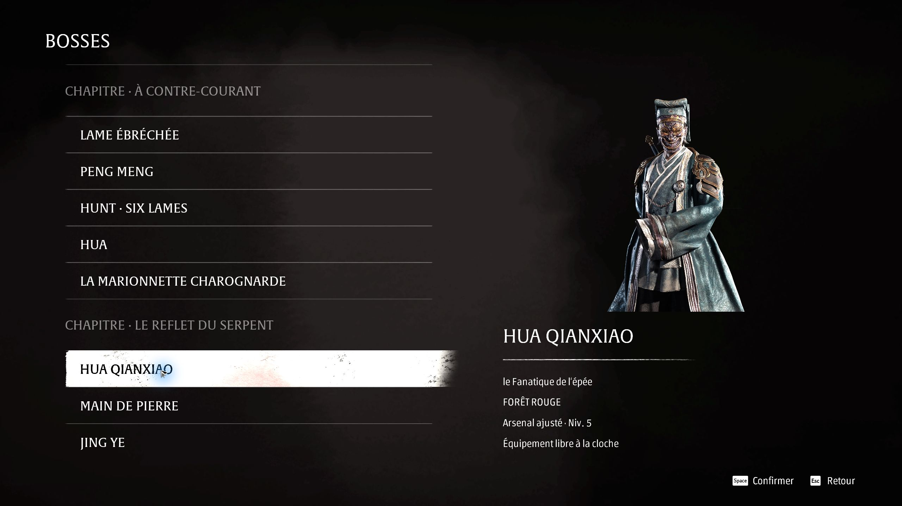

# BOSSES — Phantom Blade Zero

Mod communautaire non officiel pour rejouer les boss : **60 rencontres regroupées par chapitre**, portraits, cinq épreuves distinctes de l'homme au masque d'or et trois difficultés. Version **0.5 expérimentale**. Le menu révèle les boss du jeu : attention aux spoilers.

**[Télécharger PBZ-Bosses-0.5.zip](https://github.com/kevinbarfleur/phantom-blade-zero-bosses/releases/download/v0.5/PBZ-Bosses-0.5.zip)** · [Versions et notes](https://github.com/kevinbarfleur/phantom-blade-zero-bosses/releases)



## Installation

**Prérequis :** Windows, Steam, Phantom Blade Zero **build 26266538**, pare-feu Windows actif et droits administrateur. Lancer le jeu au moins une fois ; **une seule sauvegarde principale locale** doit exister.

Cette version attend l'installation par défaut :

```text
C:\Program Files (x86)\Steam\steamapps\common\PBZ
```

Les bibliothèques Steam personnalisées ne sont pas prises en charge. Le lanceur refuse un build différent.

1. Fermer le jeu et conserver une copie indépendante de ses sauvegardes par précaution.
2. Télécharger le ZIP ci-dessus et **tout extraire** dans un dossier permanent et inscriptible.
3. Ouvrir `Lancer-Bosses.cmd` et valider la demande Windows, nécessaire aux copies protégées, à l'installation et au pare-feu.
4. Le jeu démarre avec **BOSSES**. Aucun outil supplémentaire n'est nécessaire. Ne pas installer manuellement le `.pak` : utiliser le lanceur fourni.

Le dossier [`mod/`](mod/) contient aussi tous les fichiers prêts à utiliser si vous clonez ce dépôt.

## Jouer

1. **BOSSES** → choisir un combat : portrait et niveau d'arsenal s'affichent à droite.
2. Choisir Voyageur, Pionnier ou Explorateur des enfers, puis **maintenir le bouton indiqué 1,5 seconde**. Aucun choix de tutoriel.
3. Préparer son équipement à la cloche avant le boss. L'inventaire met le jeu en pause ; le fermer pour rejoindre l'arène.

Une mort recharge le même combat avec l'équipement choisi et les remèdes remplis. **F8**, ou le bouton à la cloche, rouvre la sélection. Après victoire : **Rejouer**, **Boss suivant**, **Sélection des boss** ou **Menu principal**. L'enchaînement automatique est facultatif.

L'arsenal comprend **24 armes, 24 lames spectrales, 51 accessoires et 15 remèdes** obtenables en campagne. Forge conservée, niveaux adaptés au combat, plafond à 30, sans bonus NG+. Les récompenses d'équipement sont bloquées pour éviter les doublons. L'équilibrage reste provisoire.

## Sauvegardes et réseau

Les sauvegardes sont copiées et vérifiées avant d'utiliser l'état temporaire du laboratoire. **Le réseau du jeu et de Steam est bloqué pendant la session**, y compris les fonctions en ligne de Steam. Les chemins de progression des succès identifiés sont désactivés ; aucune garantie générale d'absence de ban.

Pour terminer, **fermer le jeu et attendre la restauration** avant la campagne. Le gardien ferme Steam, restaure et vérifie les originaux, retire le mod, rétablit le réseau et relance Steam. L'équipement du laboratoire n'est pas ajouté à la campagne.

**Après un crash ou un arrêt brutal :** fermer le jeu puis lancer `Restaurer-Campagne.cmd`. **Ne pas déplacer ou supprimer le dossier du mod ni `.state` avant restauration** : ils contiennent les copies de secours. Pour désinstaller, restaurer d'abord, puis supprimer le dossier.

## Limites et problèmes connus

- **Mu Xiaokui et le combat final :** phases chargées ; QTE et sortie vers le menu de victoire à confirmer en jouant normalement.
- **Appui long :** événements natifs vérifiés automatiquement ; pression physique au clavier ou à la manette encore à confirmer.
- **Cinq séquences exclues :** deux rencontres de prologue/tutoriel de Zuo Shang, le chariot, la première apparition de Yucong et Hansui. Leur rejeu autonome n'est pas validé.
- **Compatibilité :** autres mods, plusieurs profils et autres PC non validés. Interface contrôlée en français, en 16:9.
- **Mises à jour :** peuvent rendre le mod incompatible. Ne pas contourner le contrôle du build ni remplacer les fichiers pendant une session.
- **Restauration refusée :** le réseau reste bloqué si la vérification échoue. Fermer le jeu et Steam, garder `.state`, relancer la restauration. Consulter le `status.json` ou `error.txt` de la session.

**Validation :** 49 tests de code réussis ; 60 contrôles automatiques des événements natifs et de l'arsenal, dont **58 menus de victoire observés**. Les dégâts de test sont désactivés dans le paquet jouable ; ces essais ne remplacent pas des combats humains complets. [Détails](mod/VALIDATION.txt) · [Arsenal](mod/ARSENAL.txt) · [Sources d'audit](mod/Sources/).

**Bug ?** Ouvrir une [issue](https://github.com/kevinbarfleur/phantom-blade-zero-bosses/issues) avec build, boss, difficulté et étapes. Ne pas joindre `.state`, des sauvegardes ou des journaux non relus : ils peuvent contenir des données personnelles.
