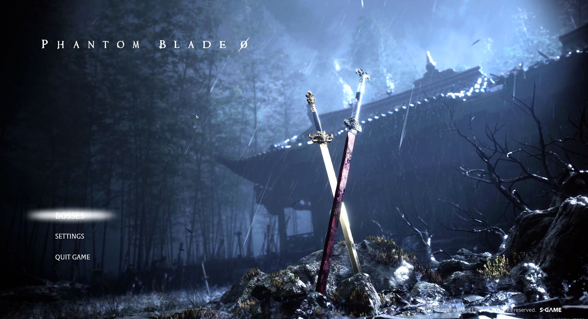

# BOSSES — Phantom Blade Zero

Choose from **59 encounters grouped by chapter**. Prepare your equipment at Inanis’s refuge, then play one fight or a series. **Experimental preview 0.7.0-preview.6 — Steam build 26367565.** The boss list contains spoilers.

PBZModLoader 1.0.2 and the exact public payload passed a scoped launch check: title screen, training refuge and level-30 inventory. All 391 source tests and 20 launcher checks passed. Targeted live tests confirmed the compact timer and mouse return to training. Full victories, controller behavior and full-series stability remain unverified.

See the [feature guide](FEATURES.md) for controls, equipment, timing and 66 HITS, and the [English test summary](mod/Validation/QA-English.md) for what has actually been checked. Earlier tests remain tied to their original builds; this update does not certify all 59 encounters again.



## Install

Requires Windows, Windows Firewall enabled, administrator access and one local campaign profile. The supported Steam installation is:

```text
C:\Program Files (x86)\Steam\steamapps\common\PBZ
```

1. After a game update, launch the unmodified game once through **Steam online**, reach the title screen and close it.
2. Download the [BOSSES preview.6 ZIP](https://github.com/kevinbarfleur/phantom-blade-zero-bosses/releases/download/v0.7.0-preview.6/PBZ-Bosses-0.7.0-preview.6.zip) and extract everything into a permanent, writable folder.
3. Download the original **[PBZModLoader 1.0.2 ZIP by LLKKFF](https://www.nexusmods.com/phantombladezero/mods/113?tab=files&file_id=2180)** separately. Leave the ZIP unchanged in your Downloads folder; the launcher checks its hash. The loader is not included in BOSSES. Do not install it manually: the BOSSES launcher deploys the verified files temporarily. Node.js and npm are not required to play.
4. Run **`Start-Bosses.cmd` normally** and accept the Windows administrator prompt. The guardian backs up your campaign, temporarily blocks network access and installs the session.

Keep an independent campaign backup. An existing loader or proxy DLL prevents installation. To upgrade, first restore your campaign using the old version’s restoration launcher, then extract the new version into a separate folder.

## Play

Select **BOSSES** at the title screen. Prepare your equipment in the refuge’s native inventory, then speak to **Inanis** or press **F8** to choose a fight. Set the run format, difficulty and timer, then hold the indicated button on **Start** for 1.5 seconds.

Native boss names and game menus follow the game’s language. Select English in the game for English native menus.

**Up/Down** selects a setting; **Left/Right** changes it. With the mouse, use the setting arrows. A single fight returns to your choice of actions after victory; a series advances through the list automatically. The native system menu also offers **Restart fight** and **Return to training**.

**66 HITS** shares a 66-hit allowance across the run. The 66th enemy hit ends the challenge and returns you to Inanis. Healing and retries do not restore the allowance. The timer is optional in either run format.

This preview adds a compact upper-right timer and fixes mouse selection in the system menu. A targeted live check confirmed the restart confirmation/cancel flow and returning to training by mouse; the actual restart was not exercised in that check.

## Restore and uninstall

**Close the game and wait for restoration before continuing your campaign.** The guardian checks the original files, removes the temporary session files and restores network access. Training equipment is not added to your campaign.

After a crash or unexpected restart, close the game and run **`Restore-Campaign.cmd` from the session’s folder**. Keep `.state` and `.dependencies` until restoration is complete. To uninstall, restore first, then delete the extracted folder.

## Game updates

A game update does not automatically require rewriting BOSSES. Changes to native scripts, assets or the loader can still break it. The launcher checks the exact Steam build and refuses an unverified build before changing game files. Wait for a compatible release rather than editing the build number in the manifest. This preview supports build **26367565** with PBZModLoader **1.0.2**.

## Current limits

- Experimental balance. Full fights, final phases and QTEs still need manual testing: **22 active encounters have specific follow-up checks**. Xue and Trial II have unconfirmed endings in diagnostic tests; that does not establish a normal-play softlock.
- Brief visual or audio artifacts may remain during transitions. Physical controller behavior, vibration and long-run stability are not fully verified. See the test summary for the scope of earlier engine-driven tests.
- Only the build, installation path and profile setup listed above are supported. Other mods and aspect ratios other than 16:9 are untested.
- Network blocking and the identified achievement safeguards do not guarantee freedom from sanctions. If Steam requires online authentication, restore first and perform a normal unmodified online launch before trying again.

Community-made and unaffiliated with the developers. Obtain the game and PBZModLoader separately from their authors.
