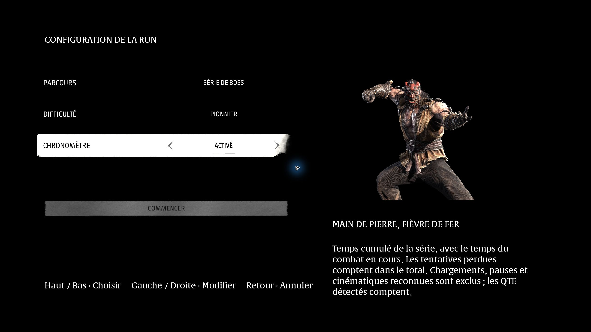

# BOSSES — Phantom Blade Zero

Rejouez **60 rencontres classées par chapitre**, préparez votre équipement chez Inanis et configurez un combat unique ou une série de boss. **0.7.0-preview.4 expérimentale — Steam build 26367565.** La liste contient des spoilers.

Cette préversion revoit la configuration des runs et les introductions. Les **60 entrées** ont été testées en jeu avec un adversaire actif et des dégâts reçus. Les essais et les points encore à vérifier sont détaillés dans le [rapport de validation](Validation/validation.json). Les combats complets et toutes leurs phases finales ne sont pas certifiés.



## Installer

Windows, pare-feu Windows actif, droits administrateur, une seule sauvegarde principale locale. Chemin Steam actuellement pris en charge :

```text
C:\Program Files (x86)\Steam\steamapps\common\PBZ
```

1. Après une mise à jour du jeu, le lancer une fois depuis **Steam en ligne, sans mod**, jusqu'au menu principal, puis le fermer.
2. [Télécharger BOSSES](https://github.com/kevinbarfleur/phantom-blade-zero-bosses/releases/download/v0.7.0-preview.4/PBZ-Bosses-0.7.0-preview.4.zip) et tout extraire dans un dossier permanent et inscriptible. Ce dossier fournit le même paquet que le dépôt.
3. Télécharger séparément le ZIP officiel **[PBZModLoader 1.0.0 de LLKKFF](https://www.nexusmods.com/phantombladezero/mods/113?tab=files&file_id=1832)**. Le conserver tel quel dans Téléchargements ; le lanceur le trouve et vérifie son empreinte. Aucun binaire de ce chargeur n'est redistribué ici.
4. Lancer **`Lancer-Bosses.cmd` normalement**, puis accepter la demande Windows du gardien. Il sauvegarde la campagne, bloque temporairement le réseau et installe les fichiers de la session. Garder ce dossier jusqu'à la restauration.

Pour changer de version, restaurer d'abord avec le `Restaurer-Campagne.cmd` de l'ancienne version et extraire la nouvelle dans un autre dossier. La cohabitation avec un chargeur ou un proxy DLL déjà installé est refusée. Une copie indépendante des sauvegardes reste recommandée.

## Jouer

**BOSSES** ouvre le refuge d'Inanis. Préparer et essayer l'équipement avec l'inventaire natif, puis parler à **Inanis** ou appuyer sur **F8** pour choisir un boss.

Le nouvel écran de configuration possède une seule sélection active :

| Réglage | Choix |
| --- | --- |
| Parcours | **Combat unique** ou **Série de boss**, à partir du boss sélectionné. |
| Difficulté | Voyageur, Pionnier, Explorateur des enfers ou **66 HITS**. |
| Chronomètre | Désactivé ou activé ; son comportement suit le parcours choisi. |

**Haut/Bas** choisit une ligne ; **Gauche/Droite** change sa valeur. À la souris, utiliser les flèches de la ligne. Descendre sur **Commencer**, puis maintenir le bouton indiqué pendant 1,5 seconde. Les réglages ne sont appliqués qu'à la validation ; Retour les annule.

L'arsenal comprend **24 armes, 24 lames spectrales, 51 accessoires et 15 remèdes obtenables en campagne**, indépendamment des découvertes de votre campagne. Tout est niveau 30 avec la forge dans le refuge ; les niveaux s'ajustent ensuite au combat, sans bonus NG+. Les récompenses d'équipement sont bloquées pour éviter les doublons. L'équilibrage reste provisoire.

Les introductions identifiées sont déclenchées sur leur scénario natif après préparation de la zone et de ses acteurs ; la cinématique place le personnage. Les autres entrées placent le personnage et la caméra face à l'adversaire ; son IA reste arrêtée pendant la préparation. Certaines introductions conservent leur déclencheur de zone natif. Si l'initialisation ne se confirme pas, un menu permet de réessayer ou de retourner à l'entraînement.

Une mort relance le combat avec le même équipement et les remèdes remplis. Dans l'inventaire natif : **SYSTÈME → Quitter le jeu → Recommencer le combat / Retourner à l'entraînement**. F8 ouvre également la sélection. Après victoire, rejouer, choisir le suivant ou revenir au refuge ; en parcours Série, le suivant part automatiquement.

## Chronomètre et 66 HITS

- **Combat unique :** temps de la tentative, remis à zéro après une mort ou un recommencement.
- **Série :** temps de combat cumulé entre les boss, avec les tentatives perdues. La série commence au boss choisi ; choisir le premier pour une run complète.
- Le chrono démarre au combat effectif. Chargements, pauses et cinématiques reconnues sont exclus ; les QTE détectés comptent. La mesure reste indicative et les séquences interactives finales nécessitent encore des essais.
- **66 HITS :** règles d'Explorateur des enfers et budget commun de 66 coups ennemis reçus. **Le 66e coup provoque la mort et termine le défi.** Se soigner, mourir ou recommencer un combat ne rembourse aucun coup ; une mort classique peut survenir avant. « Recommencer le défi » rend un budget neuf.

Une nouvelle configuration validée commence une nouvelle run. Retourner à l'entraînement l'abandonne ; fermer le jeu ne permet pas de la reprendre. « Détection à vérifier » signale un coup dont l'origine ennemie n'a pas pu être établie. Parades, dégâts périodiques, projectiles et attaques multiples restent à vérifier sur tous les boss.

## Restaurer et limites

**Fermer le jeu et attendre la restauration avant de reprendre la campagne.** Le gardien restaure et vérifie les originaux, retire les fichiers temporaires, rétablit le réseau et fait relancer Steam avec les droits normaux. L'équipement du refuge ne rejoint pas la campagne.

Après un crash ou un redémarrage brutal : fermer le jeu et lancer **`Restaurer-Campagne.cmd` depuis le dossier de la session**. Conserver `.state` et `.dependencies` jusqu'à restauration. Pour désinstaller, restaurer puis supprimer le dossier.

- Vérifier **BOSSES 0.7.0-preview.4** à l'écran titre. Les anciennes versions peuvent ne pas afficher ces options.
- Les transitions, QTE finaux, récompenses et relances de tous les combats restent à tester. Un bref fondu avant la cinématique peut subsister. Navigation à la manette physique et vibration restent à confirmer.
- Cinq séquences restent exclues : deux rencontres du prologue avec Zuo Shang, le chariot, la première apparition de Yucong et Hansui.
- Autres builds, chemins Steam personnalisés, plusieurs profils, autres mods et formats d'écran autres que 16:9 ne sont pas pris en charge. Fermer complètement le jeu pour changer les fichiers du mod.
- Le blocage réseau et la neutralisation des chemins de succès identifiés ne garantissent pas l'absence de sanction. Si le jeu demande une connexion, restaurer puis terminer un lancement normal en ligne avant de réessayer.

Code communautaire expérimental, sans affiliation aux développeurs du jeu. Le jeu et PBZModLoader doivent être obtenus séparément auprès de leurs auteurs.
